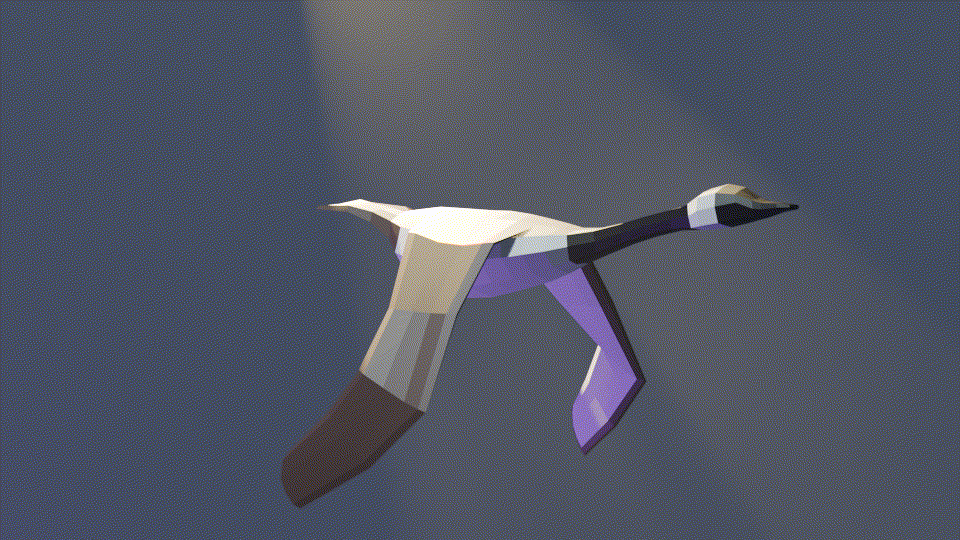

# Wings of the Tempest

*Wings of the Tempest* is a lighthearted simulation game where you guide a flock of birds on a journey across biomes. You must balance the resources of your flock, defend against predators, and outpace a relentless storm to reach your tropical home.

## Controls

| Action        | Button                |
| :------------ | :-------------------: |
| Guide flock   | Mouse position        |
| Swoop         | ?                     |
| Divert flock  | Tap right click       |
| Scatter flock | Tap left click        |
| Free cam      | F                     |
| Zoom camera   | Scroll wheel or [ & ] |

## Project organization

`/scenes` scenes that will be played (e.g. main menu, first level)  
`/modules` reusable scenes that will be instanced (e.g. camera controller, character)  
`/assets` art, textures, music, godot resource files, etc.  
